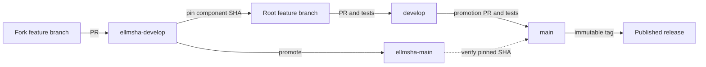
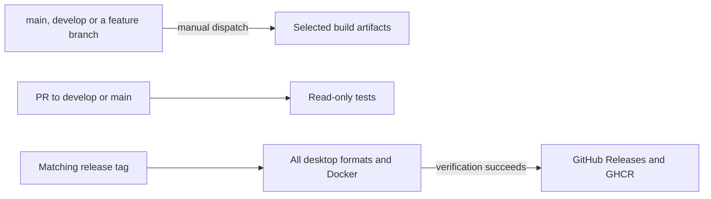

# Branching strategy

The root repository chooses the exact combination of components to ship. Each submodule entry is a commit ID. A push to a component branch becomes part of eLLMsha only after a root commit updates its gitlink.

| Purpose | Root repository | Maintained forks |
| --- | --- | --- |
| Stable source and releases | `main` | `ellmsha-main` |
| Development and integration | `develop` | `ellmsha-develop` |
| Work under review | `feature/<topic>` | `feature/<topic>` |

## Deliver a feature

1. Branch from the development line of each affected repository. Push the feature to a same-named remote branch and open a PR to the development branch.
2. Integrate component changes first. Update the root gitlinks to reachable, tested SHAs. Stage only the intended submodule paths and root files. Leave private runtime directories and BMAD output outside Git.
3. Open the root PR to `develop`. PR tests run automatically. Use the manual workflow to produce selected development packages on the PR branch or on `develop`.
4. For promotion, merge or fast-forward the intended fork commits into `ellmsha-main`, then open the root promotion PR from `develop` to `main`. Preserve the tested SHAs or update the gitlinks and re-test if the merge changes them.
5. Tag the accepted root commit to publish. For a hotfix, branch from stable and bring the fix back to development after release.



## Check out the exact source

```sh
git fetch origin
git switch develop
git submodule sync --recursive
git submodule update --init --recursive
git submodule status --recursive
```

This checks out each fork at the commit recorded by the root. The branch hints in `.gitmodules` describe the stable upstreams for explicit remote updates. Ordinary checkouts and CI follow the gitlinks. To edit a fork, create a feature branch from its development ref instead of committing on the detached checkout.



See [CI.md](CI.md) for the workflow inputs and an AppImage-only example.
