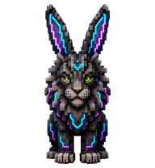
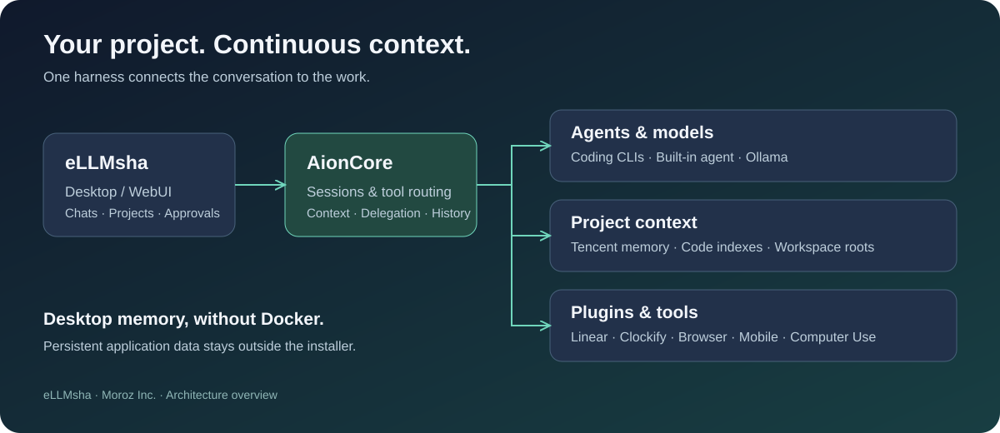
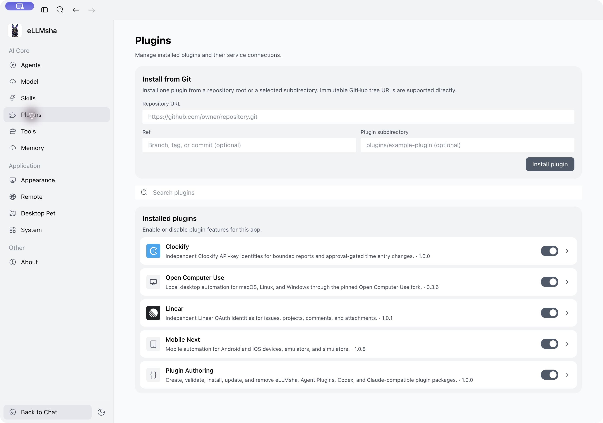
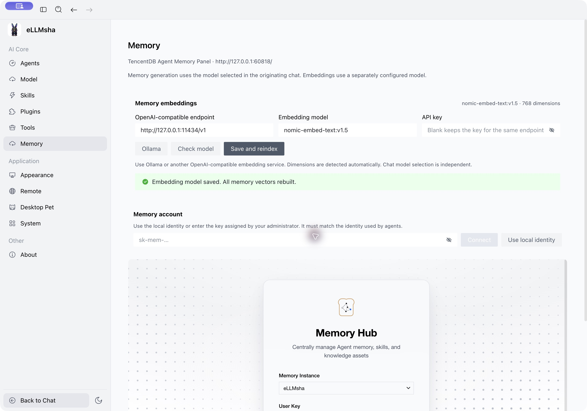

<div align="center">



# eLLMsha

**e**xtensible **L**arge **L**anguage **M**odel **s**mart **h**arness **a**rchitecture

### One workspace for your agents, code and project memory.

**Cloud models · Local models · Persistent context · Tools you can extend**

[How it works](docs/architecture.md) · [Working effectively](docs/workflows.md) · [Build desktop](scripts/release/README.md) · [VPS deployment](docs/vps-deployment.md) · [Release status](docs/release-status.md)

</div>



## Why eLLMsha exists

A product rarely fits in one repository or one chat. The backend, web app and mobile client evolve together; decisions outlive a conversation; a useful agent needs access to the tools where work actually happens.

eLLMsha brings those pieces into one desktop harness. Use your preferred coding agent, keep durable project knowledge in memory, work across several codebases and follow delegated work without losing its history.

## What you can do

| Your work | In eLLMsha |
| --- | --- |
| Move between cloud and local models | Coding-agent connections and a built-in agent with Ollama support |
| Continue a task in a fresh chat | Project memory, searchable chat history and shared workflow artifacts |
| Work on backend + frontend + mobile | Multiple workspace roots, repository discovery and per-repository code indexes |
| Delegate a bounded task | Visible parent/child activity and read-only subagent histories |
| Bring your tools | Plugin catalog, account connections, MCPs and compatible skill packages |
| Inspect a running product | In-app browser tabs, Mobile MCP and native Computer Use integrations |

**Desktop memory runs without Docker.** Its services and Node runtime are bundled with the application. Docker is an option for server deployment.

<details>
<summary><strong>See the desktop plugin catalog</strong></summary>



Actual installed macOS build, captured on a test profile without connected accounts.

</details>

<details>
<summary><strong>See memory and embedding settings</strong></summary>



Installed macOS test profile after rebuilding its fixture with a 768-dimensional local embedding model. No account credentials are shown.

</details>

## Start with the desktop

Download installers and read their changelog from the **[latest published release](https://github.com/ShiftHackZ/ellmsha/releases/latest)**. Each release states its available platforms and signing status; a source commit or tag alone is not an installer release.

1. Download the installer for your platform from the release page, or build from source using the [desktop build guide](scripts/release/README.md).
2. Open a project folder, then attach any additional codebases from the Files panel.
3. Choose an agent/model. For local inference, configure Ollama and install the models you need.
4. Open **Settings → Memory** to configure the embedding model; open **Plugins** to connect integrations.
5. Start with a concrete task and an observable definition of done.

Clone the harness together with its exact maintained fork revisions:

```bash
git clone --recurse-submodules https://github.com/ShiftHackZ/ellmsha.git
cd ellmsha
```

The root commit pins each component; do not replace those revisions with upstream `main`. See the [build guide](scripts/release/README.md) for prerequisites.

## Memory that follows the project

Chat generation follows the originating agent/model. Semantic search uses a separately configured embedding model: changing a chat model does not require re-embedding your project. Changing the embedding space does require rebuilding its vectors.

Memory stores decisions and reusable context. Chat history preserves what happened. Code indexes help locate and explore source. Each has its own lifecycle and contributes a different part of the project's context.

## Extend it with your agent

Built-in integrations live in `plugins/<plugin>`. Start with the [plugin-authoring skill](plugins/plugin-dev/skills/plugin-authoring/SKILL.md) and its [minimal template](plugins/plugin-dev/templates/basic-plugin). Describe the service, required tools and account flow; ask the agent to implement and verify the plugin in a bounded task. Keep credentials in connection settings, outside the plugin source.

## Built on maintained forks

| Component | Role |
| --- | --- |
| [AionUI](https://github.com/ShiftHackZ/ellmsha-AionUi/tree/feature/ellmsha-v2026.10.9-patch1) | Electron/React desktop and WebUI |
| [AionCore](https://github.com/ShiftHackZ/ellmsha-AionCore/tree/feature/ellmsha-v2026.10.9-patch1) | Agent sessions, tools and application services |
| [AionRS](https://github.com/ShiftHackZ/ellmsha-aionrs/tree/feature/ellmsha-v2026.10.9-patch1) | Native agent runtime |
| [TencentDB Agent Memory](https://github.com/ShiftHackZ/ellmsha-TencentDB-Agent-Memory/tree/feature/ellmsha-v2026.10.9-patch1) | Durable memory, knowledge and code indexes |
| [BMAD Method](https://github.com/ShiftHackZ/ellmsha-BMAD-METHOD/tree/feature/ellmsha-v2026.10.9-patch1) | Structured planning and delivery workflows |
| [Ponytail](https://github.com/ShiftHackZ/ellmsha-ponytail/tree/feature/ellmsha-v2026.10.9-patch1) | Simplicity-oriented engineering skills |
| [Mobile MCP](https://github.com/ShiftHackZ/ellmsha-mobile-mcp/tree/feature/ellmsha-v2026.10.9-patch1) | Android and iOS automation |
| [Chrome DevTools MCP](https://github.com/ShiftHackZ/ellmsha-chrome-devtools-mcp/tree/feature/ellmsha-v2026.10.9-patch1) | Browser inspection and automation |
| [Open Computer Use](https://github.com/ShiftHackZ/ellmsha-open-codex-computer-use/tree/feature/ellmsha-v2026.10.9-patch1) | Native desktop automation |

About shows upstream and patch provenance for the current build. Core integrations are maintained as forks; ordinary package dependencies remain ordinary dependencies. Upstream authors retain their licenses and credits. See the [component license inventory](docs/component-licenses.md).

## Project status

macOS arm64 packaging, installed launch and chat/memory persistence have been exercised. Release automation targets macOS DMG/ZIP, Windows x64 EXE and Linux VPS container images. Current build, signing and runtime evidence is recorded per release; configured targets are not proof of successful builds or installation tests. Some integration checks require your account or OS permissions.

See [the evidence and remaining release checks](docs/release-status.md) before deploying.

---

**Copyright © 2026 Moroz Inc.** Original root-repository material is licensed under [AGPLv3](LICENSE) (`AGPL-3.0-only`), with a separate paid commercial licensing option. Commercial use under AGPLv3 remains permitted. Upstream components retain their own licenses. See [licensing and commercial inquiries](LICENSING.md).
