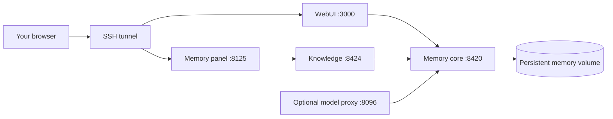

# Run eLLMsha on a VPS

The desktop bundles its memory services. A Linux VPS uses containers and persistent server storage. This guide includes an [all-services Compose overlay](../docker/compose.vps.yaml) with an explicit first-time bootstrap. A clean-host deployment test remains a release gate.

## Topology



The root [compose.yaml](../compose.yaml) runs WebUI on the external `tdai-memory-stack` network. The [launcher](../scripts/v3.sh) starts core, hub and proxy through the maintained Tencent deployment scripts, provisions the memory identity, then starts Compose. Do not assume `docker compose up` alone provisions the whole product.

## Prepare a private server checkout

Use Linux with Docker Engine and Compose v2, Node.js, Python 3, Git and rsync. Obtain the exact maintained source revisions, including AionRS; the [source publication gate](release-status.md) currently prevents promising a reproducible public recursive clone.

From the repository root:

```sh
scripts/v3.sh init
```

Edit `.env` privately. It is sourced by shell scripts, so use shell-compatible assignments and quote values when needed. Keep `TDAI_BIND_HOST=127.0.0.1`. Choose the embedding endpoint/model/dimensions separately from the chat model. Set the proxy upstream fields required by the current launcher, even when the agent itself uses another provider.

`host.docker.internal` points at the VPS host from containers, not your laptop. A service bound only to the host's loopback may not accept traffic arriving through Docker's host gateway. Verify the intended endpoint from the container network before indexing. Do not expose a local model server publicly to solve this routing issue.

Keep the default memory ports for this candidate: `bootstrap-memory.py` currently targets core port 8420 directly. Set `V3_WORKSPACES_DIR` to the directory of repositories the server agent should access.

## Build the maintained memory images

For a Linux amd64 host:

```sh
docker build -t ellmsha-memory-core:local tencentdb-agent-memory/MemoryCore
IMAGE_NAME=ellmsha-memory-hub IMAGE_TAG=local PLATFORM=linux/amd64 \
  bash tencentdb-agent-memory/deploy/panel-knowledge-combined/build.sh
```

Use `PLATFORM=linux/arm64` on an arm64 host. The hub recipe prepares its build context from MemoryPanel and MemoryKnowledge; invoking its Dockerfile against an arbitrary directory will not supply those inputs.

Before launching, prepare the three fork runtimes with their scripts:

```sh
node scripts/prepare-mobile-mcp.js
node scripts/prepare-chrome-devtools-mcp.js
node scripts/prepare-open-computer-use.js
scripts/v3.sh doctor
scripts/v3.sh up
scripts/v3.sh status
```

The launcher validates runtime provenance and builds WebUI. Its initial bootstrap creates private identity files under `.data/tencentdb`; retain these with the corresponding memory volumes. A restored database without its identity configuration is not a complete restore.

## Run the whole stack with Compose

The example uses SQLite storage, the same persistent volumes and generated configuration as the initial launcher. It requires the successful bootstrap above. Do not use it to switch an existing MongoDB deployment to SQLite.

After initial provisioning, stop the bootstrap containers while preserving their volumes, then hand service management to Compose:

```sh
scripts/v3.sh down
docker compose --env-file .env -f compose.yaml -f docker/compose.vps.yaml config --quiet
docker compose --env-file .env -f compose.yaml -f docker/compose.vps.yaml up -d --wait
docker compose --env-file .env -f compose.yaml -f docker/compose.vps.yaml ps
```

Always supply both files in that order, from the repository root. The overlay manages WebUI, memory core, the combined panel/knowledge hub and model proxy. Core and hub health checks gate dependent services. External volume declarations require the provisioned volumes to exist; configuration file mounts fail if the files are missing.

Once using this overlay, manage shutdown with the same Compose files:

```sh
docker compose --env-file .env -f compose.yaml -f docker/compose.vps.yaml down
```

Do not run the bootstrap launcher concurrently with the Compose stack: both use the same network service names, ports and data. The overlay reuses generated configuration; editing embedding/proxy fields in `.env` alone does not regenerate the mounted YAML files. Configuration changes need a stopped stack and deliberate regeneration through the bootstrap path before returning to Compose. The default proxy image uses a mutable `latest` tag; pin an audited digest in `PROXY_IMAGE` before a reproducible release deployment.

Validate syntax without real credentials or a running Docker daemon:

```sh
KNOWLEDGE_SERVICE_KEY=example-validation-only docker compose \
  --env-file .env.example -f compose.yaml -f docker/compose.vps.yaml config --quiet
```

This command checks the configuration model, not image builds, service health or authentication. Avoid printing resolved configuration from a real `.env`, because it contains credentials.

## Connect from your computer

With the default ports, create an SSH tunnel from your computer:

```sh
ssh -N -L 3000:127.0.0.1:3000 -L 8125:127.0.0.1:8125 user@your-vps
```

Open `http://127.0.0.1:3000` and the memory panel at `http://127.0.0.1:8125`. Change the local tunnel port if another application uses it. Direct public ingress requires a separately configured TLS/authentication boundary; that deployment has not been accepted in this candidate.

## Preserve data during updates

| Storage | Contains |
| --- | --- |
| `.data/aionui` | WebUI/application state |
| `.data/tencentdb` | Identity, service configuration and bootstrap files |
| `ellmsha-v3-memory-core` volume | Memory core persistent data |
| `ellmsha-v3-memory-panel` volume | Knowledge and panel persistent data |
| Your configured workspace directory | Project source and working files |

Stop writers before making a consistent backup of these locations. Encrypt backups containing account configuration. Keep the previous source revision and images until a restored copy has passed chat and memory read-back checks. Replacing an image does not replace its mounted data; removing a volume does. Avoid volume deletion and pruning during updates.

## Acceptance still required

- Build and start the full stack on a clean Linux host.
- Exercise the bootstrap-to-Compose handoff and service readiness on a clean host.
- Verify model callback routing, embeddings, multi-repository indexing and live model streaming after reconnect.
- Exercise an actual version upgrade and restore across application/database versions.
- Confirm which browser/mobile/desktop tools are usable in the server environment; a headless container does not automatically control a user's desktop or simulators.

### Verification performed

On 2026-10-10 the current WebUI, Memory Core and Memory Hub images were built with Docker's Linux arm64 engine. An isolated copy of the Compose configuration used fresh volumes, a private QA network, random localhost ports and a synthetic identity. WebUI returned HTTP 200; core, panel, knowledge and proxy health endpoints responded. After removing and recreating the containers while retaining volumes, the same identity authenticated and the existing memory fixture read back correctly without rewriting it.

The final WebUI image also passed real form login, Plugins loading, enable/disable persistence and logout. Anonymous/invalid-token HTTP and WebSocket access was rejected; authenticated cookie WebSocket connection and reconnection received an authenticated route response. Machine-wide plugin mutation routes were rejected in WebUI mode. A subsequent authenticated event check observed conversation, message, runtime-error and turn-completion events. After a deliberate WebSocket interruption with HTTP still available, native browser QA confirmed that missed messages and persisted runtime state recovered without reloading. This used a deterministic missing-workspace error before provider execution; live model streaming and multi-user browser behavior remain outside this check.

For backup/restore, all writers in the isolated QA stack were stopped, both named memory volumes were archived, and application data plus identity configuration were copied privately. Archives were restored into new volumes and a separate stack. The original credentials authenticated; memory content/identity, WebUI user and conversation-list responses matched the original stack. Original volumes were retained. This verifies a same-version synthetic restore, not cross-version migration or complete conversation/attachment recovery.

A separate fresh-container check invoked the actual `scripts/bootstrap-memory.py` module with isolated paths and endpoint overrides, leaving its identity/request/configuration logic unchanged. The first run created identities, a repeat run retained them, and generated configuration drove the packaged memory MCP through write/read/search and container recreation. This used `provider=none`, testing storage and full-text search rather than embeddings. It did not execute the unmodified `scripts/v3.sh` launcher or default-name/default-port bootstrap-to-Compose handoff on an independent VPS host.
